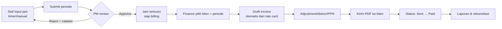

# PRD — Sistem Timesheet & Billing Jam Kerja Proyek

| | |
|---|---|
| **Versi** | 1.0 (Draft) |
| **Tanggal** | 19 Oktober 2026 |
| **Penulis** | Ikomang Pradnya Wiryatama |
| **Status** | Draft untuk review stakeholder |
| **Target rilis MVP** | 8 minggu sejak disetujui |

---

## 1. Ringkasan Produk

Sistem web untuk mencatat jam kerja per proyek (timesheet), mengesahkan jam tersebut melalui approval, lalu mengubah jam yang disetujui menjadi tagihan (billing/invoice) ke klien berdasarkan rate card yang berlaku.

**Masalah yang diselesaikan:**

- Pencatatan jam kerja masih manual (spreadsheet) → rawan salah input, jam hilang, dan tidak dapat diaudit.
- Perhitungan tagihan dilakukan manual → *revenue leak* (jam tercatat tapi tidak tertagih) dan sengketa dengan klien soal jumlah jam.
- PM tidak punya visibilitas real-time atas konsumsi anggaran proyek.

**Target hasil (OKR):**

| Hasil | Ukuran keberhasilan |
|---|---|
| Akurasi billing | 100% invoice sesuai jam approved (0 selisih tanpa koreksi manual) |
| Waktu buat invoice | < 5 menit per proyek per periode (sebelumnya ± 2 jam) |
| Timesheet tepat waktu | ≥ 95% karyawan submit sebelum deadline periode |
| Sengketa klien | Turun ≥ 50% dalam 3 bulan pasca rilis |

---

## 2. Target Pengguna (Persona)

| Persona | Peran | Kebutuhan utama | Pain point |
|---|---|---|---|
| **Anda — Staf/Engineer** | Input jam | Catat jam cepat, tanpa ribet, lihat jam yang sudah disetujui | Lupa catat jam, form panjang |
| **PM/Lead** | Reviewer | Setujui/reject jam massal, lihat burn rate proyek | Jam menumpuk, telat tahu budget terlampaui |
| **Finance/Billing** | Pembuat tagihan | Generate invoice dari jam approved, atur diskon/adjustment | Rekap manual dari banyak sheet |
| **Klien** | Penerima invoice | Lihat rincian jam & durasi pekerjaan yang ditagih | Tidak transparan, tidak bisa verifikasi |
| **Admin Sistem** | Konfigurator | Kelola user, role, rate card, proyek, periode lock | Konfigurasi tercecer |

---

## 3. Lingkup (In Scope) & Luar Lingkup

### 3.1 In Scope

1. Manajemen klien & proyek
2. Rate card (tarif per jam per peran/per orang, multiplier lembur/libur)
3. Timesheet: timer berjalan & input manual, kategori *billable/non-billable*
4. Workflow approval berlapis (Staf → PM → Finance)
5. Generasi invoice otomatis dari jam approved
6. Laporan: utilisasi, jam billable, margin proyek, export CSV/Excel/PDF
7. Role-based access control (RBAC) + audit log
8. Notifikasi email (reminder submit, approval, invoice jatuh tempo)

### 3.2 Out of Scope (v1)

- Penggajian/payroll dan potongan pajak
- Integrasi bank/pembayaran online (payment gateway) — status invoice ditandai manual di v1
- Aplikasi mobile native (web responsive saja)
- Time tracking otomatis dari screenshot/aktivitas keyboard
- Multi-currency & multi-cabang (Rupiah saja di v1)

---

## 4. User Story & Acceptance Criteria

### F1 — Manajemen Klien & Proyek

> **US-01:** Sebagai *Admin*, saya dapat membuat klien dan proyek beserta tanggal mulai/akhir, budget jam, dan anggaran uang, sehingga tim punya wadah pencatatan jam yang jelas.

**AC:**
- Form klien: nama, email, PIC, negara/alamat (opsional) → validasi wajib isi nama & email format valid.
- Form proyek: klien, nama proyek, tanggal mulai/akhir, budget jam, budget uang (opsional), status `Draft → Active → Completed → Archived`.
- Saat budget jam terlampaui 80% dan 100%, sistem menampilkan peringatan pada halaman proyek.
- Proyek `Archived` tidak menerima time entry baru.
- Daftar proyek dapat difilter per klien/status dan dicari (debounce 300ms).

### F2 — Rate Card

> **US-02:** Sebagai *Finance*, saya dapat mengatur tarif per jam per proyek/per orang sehingga tagihan dihitung otomatis dan konsisten.

**AC:**
- Rate card punya hierarki: *rate per orang (override) > rate per peran > rate default proyek*.
- Mendukung multiplier: lembur (>8 jam/hari) ×1.5, hari libur/weekend ×2, hari raya ×3 (konfigurabel).
- Perubahan rate hanya berlaku untuk time entry dengan tanggal ≥ tanggal efektif rate (tidak mengubah invoice lama).
- Tidak ada rate aktif → time entry ditandai `needs_rate` dan menghalangi invoice.

### F3 — Timesheet

> **US-03:** Sebagai *Staf*, saya dapat mencatat jam kerja harian per proyek/task, baik lewat timer maupun input manual, sehingga saya tidak kehilangan jam kerja.

**AC:**
- Input manual: tanggal, proyek, task/deskripsi (min. 5 karakter), jam mulai–selesai, kategori `Billable | Non-billable | Internal`.
- Timer: start/pause/stop; timer berjalan maksimal 1 entry aktif; refresh halaman tidak menghapus timer (persist ke server).
- Validasi: total jam per hari ≤ 24 jam; overlap antar entry pada tanggal sama ditolak dengan pesan jelas.
- Timesheet mingguan menampilkan grid Sen–Min per proyek dengan total otomatis.
- Submit periode → status `Draft → Submitted`; setelah submit terkunci untuk diedit sampai ditolak/dibuka admin.
- Periode yang sudah di-lock admin tidak bisa diubah siapa pun.
- Pengingat otomatis: email H-1 sebelum deadline submit periode.

### F4 — Workflow Approval

> **US-04:** Sebagai *PM*, saya dapat menyetujui atau menolak timesheet secara massal dengan catatan, sehingga jam siap ditagih tanpa bolak-balik.

**AC:**
- Alur: `Submitted → Approved (PM) → Locked untuk billing` atau `Rejected` (+catatan wajib) → kembali ke staf untuk revisi.
- Approve/reject massal per proyek/periode, dengan konfirmasi jumlah jam terdampak.
- Approval otomatis (rule-based) opsional: entry ≤ 8 jam/day milik staf tertentu auto-approve.
- Semua aksi tercatat di audit log (siapa, kapan, IP, sebelum→sesudah).
- Notifikasi email ke staf saat approve/reject.

### F5 — Billing & Invoice

> **US-05:** Sebagai *Finance*, saya dapat membuat invoice dari jam yang sudah disetujui hanya dengan satu klik, sehingga penagihan cepat dan dapat dipertanggungjawabkan.

**AC:**
- Pilih klien + periode → sistem mengambil semua `Approved` entries yang belum ditagih → draft invoice dengan rincian per proyek/per jam.
- Invoice line: deskripsi, qty (jam), rate, subtotal; mendukung diskon (% atau nominal), biaya tambahan, dan PPN (konfigurabel).
- Nomor invoice otomatis urut per tahun: `INV/YYYY/####`.
- Status: `Draft → Sent → Paid → Overdue` (+ `Void`); transisi status tervalidasi dan ter-audit.
- Invoice yang sudah `Sent` tidak bisa diedit hanya via credit note/koreksi.
- Export PDF (format A4, kop klien) dan kirim email invoice ke PIC klien.
- Sisa jam proyek yang belum ditagih tampil di dashboard (mencegah *revenue leak*).
- **Wajib ada jejak audit:** setiap baris invoice dapat ditelusuri ke daftar time entry aslinya (*drill-down*).

### F6 — Laporan & Dashboard

> **US-06:** Sebagai *PM/Finance*, saya dapat melihat laporan utilisasi, jam billable vs non-billable, dan margin per proyek untuk pengambilan keputusan.

**AC:**
- Dashboard: jam minggu ini (per orang/per proyek), total belum di-approve, invoice outstanding, proyek melewati budget.
- Laporan filter: rentang tanggal, klien, proyek, anggota, kategori.
- Rekap per periode → total jam, nilai billing, HPP (jika diisi hourly cost internal), dan margin.
- Export CSV/Excel untuk semua laporan; PDF ringkasan bulanan.
- Query laporan 12 bulan ≤ 3 detik (lihat NFR-1).

### F7 — RBAC, Audit & Notifikasi

> **US-07:** Sebagai *Admin*, saya dapat mengontrol akses per peran dan melacak semua perubahan penting.

**AC:**

| Role | Klien/Proyek | Rate card | Timesheet sendiri | Timesheet orang lain | Approve | Invoice | User mgmt |
|---|---|---|---|---|---|---|---|
| Staf | read (proyeknya) | — | CRUD+submit | — | — | — | — |
| PM | read | read | miliknya | read+approve | ✅ | read | — |
| Finance | CRUD | CRUD | miliknya | read | — | CRUD | — |
| Admin | CRUD | CRUD | semua | semua | ✅ | CRUD | CRUD |
| Klien | read (proyeknya) | — | — | — | — | read (inv-nya) | — |

- Semua perubahan data kritikal (approval, rate, invoice, status) masuk `audit_log` (actor, entity, action, before/after JSON, timestamp, IP).
- Notifikasi email: submit reminder, hasil approval, invoice terkirim, invoice jatuh tempo (H-3 & H+1), ringkasan mingguan.

---

## 5. Alur Utama

---

## 6. Model Data (Entitas Inti)

| Entitas | Field kunci | Relasi |
|---|---|---|
| `client` | id, name, email, pic, status | 1 → n `project` |
| `project` | id, client_id, name, start/end, budget_hours, budget_amount, status | n → 1 `client`, 1 → n `member`, `time_entry` |
| `user` | id, name, email, role, hourly_cost, status | n → n `project` (via `project_member`) |
| `rate_card` | id, scope(project/role/user), rate, multiplier_type, effective_from/to | → `project`, `user` |
| `time_entry` | id, user_id, project_id, date, start/end, duration_min, category, description, status | → `timesheet_period`, `invoice_line` |
| `timesheet_period` | id, week/month, deadline, submitted_at, status | 1 → n `time_entry` |
| `approval` | id, period_id, approver_id, decision, note, decided_at | → `timesheet_period` |
| `invoice` | id, number, client_id, period, subtotal, discount, tax, total, status, due_date | 1 → n `invoice_line` |
| `invoice_line` | id, invoice_id, project_id, hours, rate, amount | n → n `time_entry` (junction `invoice_entry`) |
| `audit_log` | id, actor_id, entity, action, before, after, ip, created_at | — |

**Aturan kunci:** `time_entry` hanya boleh masuk **satu** invoice; status entry berubah menjadi `billed` setelah invoice `Sent`. Periode yang di-lock bersifat *immutable*.

---

## 7. Kebutuhan Non-Fungsional (NFR)

| ID | Kategori | Keterangan | Target |
|---|---|---|---|
| NFR-1 | Performa | Waktu muat dashboard & laporan (p95) | ≤ 2 detik, laporan 12 bln ≤ 3 detik |
| NFR-2 | Skala | Pengguna serentak / data | 200 concurrent user; 1 juta time_entry (3 thn) tanpa degradasi |
| NFR-3 | Ketersediaan | Uptime layanan | 99.5% (jam kerja 08.00–18.00 WIB) |
| NFR-4 | Keamanan | OWASP Top 10, enkripsi | TLS 1.2+, AES-256 at rest, password hashing (bcrypt/argon2), MFA opsional untuk Admin/Finance |
| NFR-5 | Keamanan | Sesi & akses | Session 8 jam idle expired, JWT rotasi refresh, rate limit login 5 percobaan/15 menit |
| NFR-6 | Data | Backup & recovery | Backup harian, RPO 24 jam, RTO 4 jam, retensi log audit ≥ 2 tahun |
| NFR-7 | Usability | Aksesibilitas & responsif | WCAG 2.1 AA untuk alur utama; mobile responsive untuk staf input jam |
| NFR-8 | Auditabilitas | Jejak perubahan | 100% perubahan data kritikal tercatat & tidak bisa dihapus via UI |
| NFR-9 | Lokalisasi | Bahasa & zona waktu | Bahasa Indonesia, zona waktu Asia/Jakarta (per user dapat diubah) |

---

## 8. Kriteria Penerimaan MVP (Definition of Done)

MVP dinyatakan **lolos** bila seluruh terpenuhi:

1. Staf dapat input jam (timer & manual), submit periode, menerima email hasil approval.
2. PM dapat approve/reject massal dengan catatan; staf melihat hasilnya.
3. Finance dapat membuat invoice dari jam approved dalam < 5 menit, termasuk diskon/PPN, nomor urut otomatis, dan export PDF.
4. Setiap baris invoice dapat di-*drill-down* ke time entry aslinya (jejak audit penuh).
5. Laporan utilisasi & jam billable tersedia dengan export CSV; query 12 bulan ≤ 3 detik.
6. RBAC sesuai tabel §4-F7 diuji dengan 5 role.
7. Skenario negatif diuji: jam overlap ditolak, entry non-approved tidak bisa ditagih, entry sudah `billed` tidak bisa masuk invoice kedua, periode terkunci tidak bisa diedit.
8. Tidak ada bug prioritas *blocker/critical* terbuka; *major* ≤ 3 dengan workaround terdokumentasi.
9. Dokumentasi admin (setup, konfigurasi rate card, alur approval) dan panduan pengguna tersedia.
10. passing unit test ≥ 80% pada modul kalkulasi (billing, rate, durasi) dan integration test seluruh alur F3–F5.

---

## 9. Milestone

| Fase | Durasi | Deliverable |
|---|---|---|
| **M1 — Fondasi** | Minggu 1–2 | Auth + RBAC, master klien/proyek/user, skema DB, audit log |
| **M2 — Timesheet** | Minggu 3–4 | Timer & input manual, grid mingguan, submit/periode lock, pengingat email |
| **M3 — Approval** | Minggu 5 | Workflow approve/reject massal, notifikasi, dashboard PM |
| **M4 — Billing** | Minggu 6–7 | Rate card, generator invoice, adjustment/PPN, PDF, status invoice |
| **M5 — Laporan & Hardening** | Minggu 8 | Laporan + export, dashboard keuangan, UAT, hardening keamanan, rilis MVP |

---

## 10. Asumsi, Risks & Pertanyaan Terbuka

**Asumsi**
- Satu organisasi (tanpa multi-tenant), mata uang IDR, periode waktu mingguan (dapat diperluas ke bulanan).
- Budget uang dihitung dari jam × rate, bukan kontrak *fixed price*.

**Risiko**

| Risiko | Dampak | Mitigasi |
|---|---|---|
| Adopsi input jam rendah | Billing tidak akurat | Timer 1 klik, mobile-first, pengingat otomatis, integrasi kalender |
| Perubahan rate membingungkan | Sengketa tagihan | Rate bersifat efektif-dari-tanggal, invoice lama immutable, preview selisih sebelum simpan |
| Klien memperdebatkan rincian jam | Tunda pembayaran | Rincian jam per baris invoice + export yang dapat dibuka klien |

**Pertanyaan terbuka (perlu keputusan stakeholder sebelum M2)**
1. Periode tagihan per klien: mingguan, bulanan, atau per proyek?
2. Apakah PM boleh approve timesheet proyek yang ia kelola sendiri (sebagai staf), atau wajib orang lain (*four-eyes principle*)?
3. Perlu approval level ketiga (client sign-off) sebelum invoice final?
4. Definisi jam lembur harian (di atas berapa jam) dan hari libur nasional mana yang berlaku?

---

*Dokumen ini bersifat hidup — pembaruan dicatat pada tabel versi dan disetujui ulang oleh stakeholder sebelum masuk sprint.*
